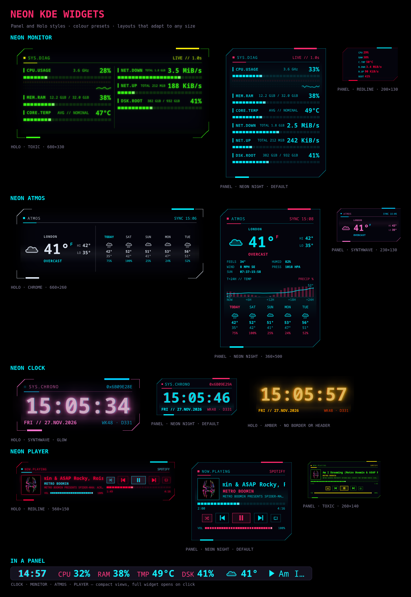

# Neon KDE Widgets

Neon HUD-style widgets for the KDE Plasma desktop: glowing accents, scanlines and glitch effects, with colour presets and a translucent Holo style that blends into your wallpaper. Every widget has a settings page to choose what it shows.

**Requires KDE Plasma 6.** Plasma 5 is not supported.



## Widgets

| Widget | What it shows |
|---|---|
| **Neon Clock** | Digital clock and date with optional glitch effect |
| **Neon Monitor** | CPU, RAM, swap, temperatures, GPU, network, disk activity and storage, with history graphs and alert colours |
| **Neon Atmos** | Current weather, 24-hour graph and daily forecast for a city you choose |
| **Neon Player** | Now playing from any media player (Spotify, browsers, VLC, mpv…), with album art and playback controls |

## Installation

Widgets install for your user only. No root access is needed.

### Install script

Get the files, either way:

- **Download:** on this repository's GitHub page, click **Code** → **Download ZIP**, extract the archive, and open a terminal in the extracted folder.
- **Git:** `git clone https://github.com/sndpkiran/neon-kde-widgets.git && cd neon-kde-widgets`

Then run:

```sh
./install.sh
```

If you get "Permission denied", run `bash install.sh` instead.

Type the numbers of the widgets you want (or `a` for all), press Enter, and answer `y` to restart the desktop. Then right-click the desktop → **Add Widgets…** and drag the widget onto your desktop or a panel.

The script also takes arguments:

| Command | Does |
|---|---|
| `./install.sh all` | Install all widgets, or update them if already installed |
| `./install.sh clock player` | Only these (`clock`, `monitor`, `atmos`, `player`) |
| `./install.sh -r atmos` | Uninstall |
| `./install.sh -l` | Show which are installed |
| `./install.sh all -s` | Restart the desktop afterwards without asking |

To update later, download the files again (or `git pull`) and run `./install.sh all`.

### Manually with `kpackagetool6`

```sh
kpackagetool6 -t Plasma/Applet -i ./neon-clock                       # install
kpackagetool6 -t Plasma/Applet -u ./neon-clock                       # update
kpackagetool6 -t Plasma/Applet -r io.github.sndpkiran.neonclock      # uninstall
systemctl --user restart plasma-plasmashell
```

`-r` takes the plugin ID, not the folder:

| Folder | Plugin ID |
|---|---|
| `neon-clock/` | `io.github.sndpkiran.neonclock` |
| `neon-monitor/` | `io.github.sndpkiran.neonmonitor` |
| `neon-atmos/` | `io.github.sndpkiran.neonatmos` |
| `neon-player/` | `io.github.sndpkiran.neonplayer` |

## Troubleshooting

**Widget not showing up, or changes not appearing after an update?** Plasma loads widget code when it starts, so restart it:

```sh
systemctl --user restart plasma-plasmashell
```

Your open apps aren't affected. On systems without systemd, use `kquitapp6 plasmashell && kstart plasmashell` instead. If that doesn't help, log out and back in.

## Privacy and notes

- **Neon Atmos** gets weather from [Open-Meteo](https://open-meteo.com/). It sends the chosen location's coordinates, rounded to about 1 km, on every refresh, and the city name when you search for one in its settings. Nothing is sent until a location is set.
- **Neon Player** uses Plasma's own media player module (`org.kde.plasma.private.mpris`). It's a private API, so a major Plasma update could break it.
- **Neon Monitor** reads sensors from ksystemstats and storage from `df`. Available sensors depend on your hardware; missing ones show a message such as `NO GPU SENSOR` instead of a reading. It needs the `ksystemstats` service (and its `libksysguard` library), which very minimal Plasma installs can leave out: if the widget says `SENSORS OFFLINE`, install `ksystemstats` with your package manager and log out and back in. Storage keeps working either way.

## License

[GPL-3.0-or-later](LICENSE)
